# Veritest

Aplikasi kuis pilihan ganda berbasis Flutter.

## Identitas Mahasiswa

| |                       |
|---|-----------------------|
| **Nama** | Naswa Zhahira         |
| **NIM** | 241401059             |
| **Lab** | Pemorograman Mobile 4 |

## Informasi Aplikasi

### Nama Aplikasi
**Veritest**

### Deskripsi Singkat
Veritest adalah aplikasi kuis pilihan ganda yang dibuat dengan Flutter dan Dart. Pengguna dapat mendaftar atau masuk, memilih kategori kuis, menjawab soal dengan pembahasan di setiap jawaban, lalu melihat skor, riwayat permainan, dan peringkat pengguna lain. Data disimpan secara lokal di memori (tanpa database), sehingga data akan hilang ketika aplikasi ditutup.

### Fitur-fitur yang Tersedia
- **Autentikasi**: daftar akun baru dan masuk dengan email dan kata sandi (akun demo: `demo@kuis.com` / `123456`).
- **6 kategori kuis**, masing-masing 10 soal: Flutter & Dart, Pengetahuan Umum, Matematika Dasar, Teknologi, Sains, dan Bahasa Indonesia.
- **Soal diacak** setiap kali kuis dimulai.
- **Pembahasan** muncul setelah soal dijawab.
- **Halaman hasil**: skor, persentase, dan review seluruh jawaban benar/salah.
- **Riwayat**: daftar permainan milik akun yang sedang masuk.
- **Papan peringkat**: urutan pengguna berdasarkan skor terbaik, dengan penanda untuk akun sendiri dan medali untuk 3 teratas.
- **Profil**: statistik (jumlah dimainkan, skor terbaik, rata-rata).
- **Edit profil**: ubah nama, ganti kata sandi, dan pilih salah satu dari 9 avatar lewat pop up.
- **Tema terang/gelap** yang bisa diganti dari halaman profil.

## Cara Menjalankan

```bash
git clone https://github.com/naswazhahira/Veritest.git
cd NAMA-REPO
flutter pub get
flutter run
```

Kebutuhan: Flutter SDK dengan Dart `>=3.4.0 <4.0.0`.

## Dokumentasi

### Credit Aset

| Aset | Sumber / Keterangan                                                                      |
|---|------------------------------------------------------------------------------------------|
| Font **Poppins** | [Google Fonts](https://fonts.google.com/specimen/Poppins), lisensi SIL Open Font License |
| Package **provider** | [pub.dev/packages/provider](https://pub.dev/packages/provider)                           |
| Ikon | Material Icons bawaan Flutter                                                            |
| Framework | [Flutter](https://flutter.dev) dan bahasa Dart                                           |
| Avatar (9 gambar) | Dibuat menggunakan Gemini                                                                |
| Logo Veritest | Dibuat sendiri menggunakan Figma          |
| Soal-soal kuis | Ditulis sendiri sebagai data dummy lokal                                                 |

### Screenshot Tiap Halaman

| Halaman             | Screenshot                                      |
|---------------------|-------------------------------------------------|
| Login               | 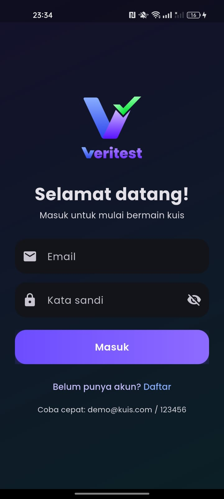           |
| Daftar              | 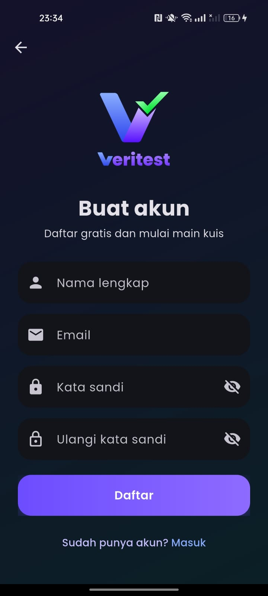       |
| Beranda             | 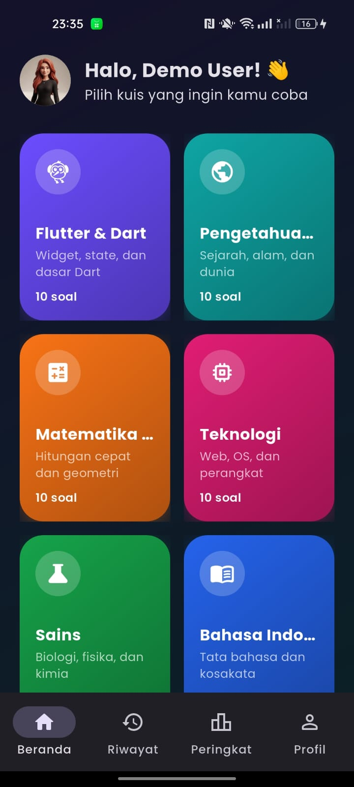          |
| Kuis Benar          | 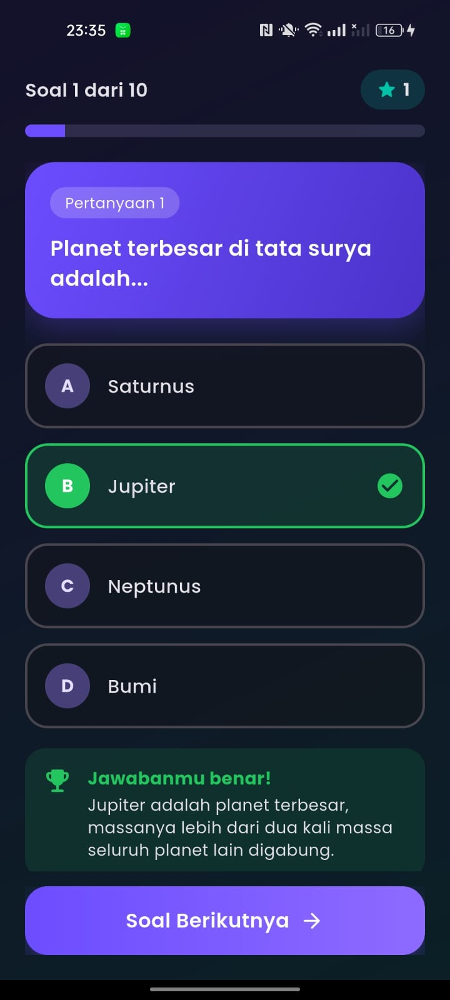        |
| Kuis Salah          | 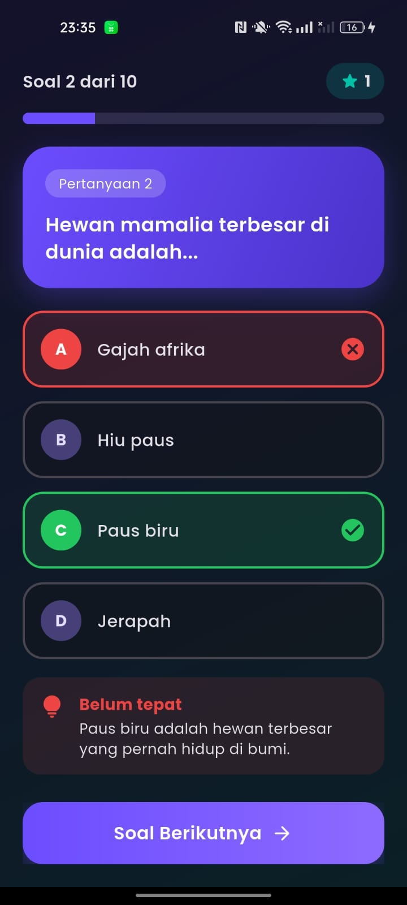 
| Hasil               | 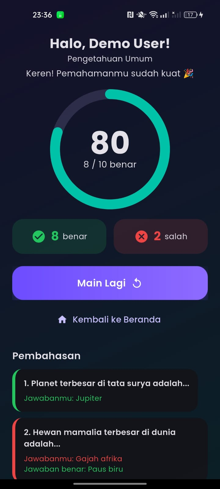          |
| Riwayat             | 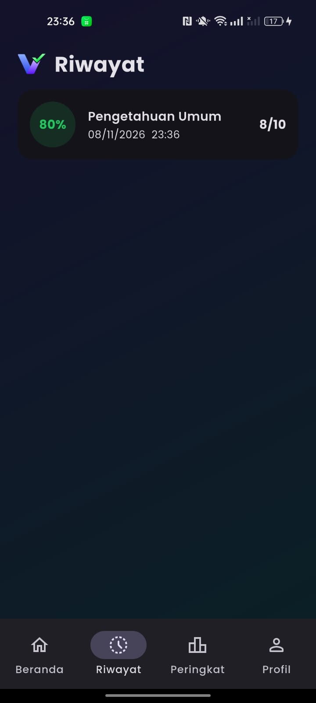       |
| Peringkat           | 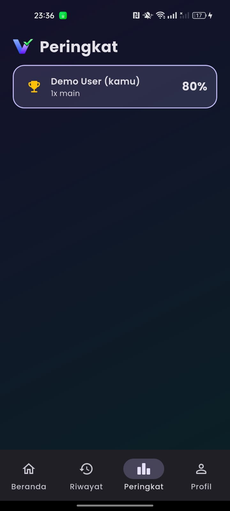 |
| Profil              | 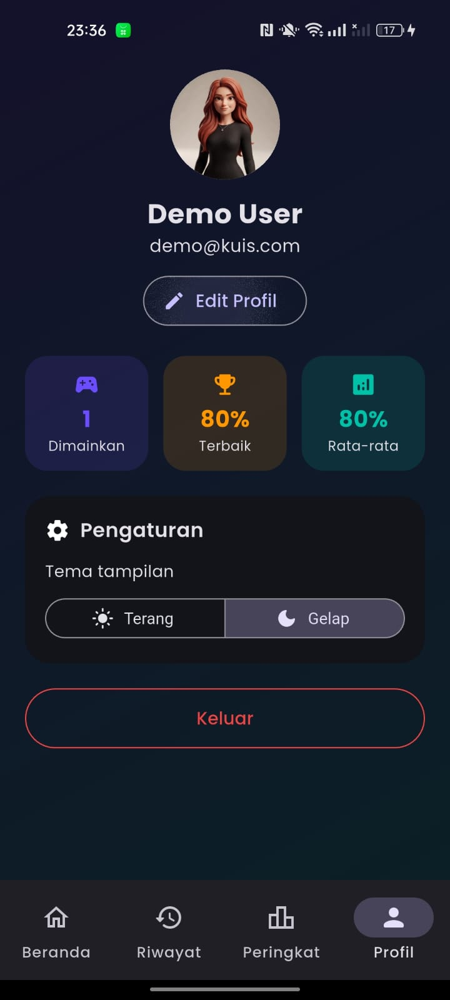        |
| Edit Profil         | 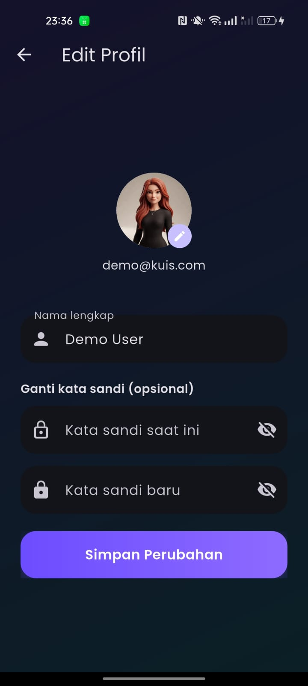 |
| Pop up Pilih Avatar | 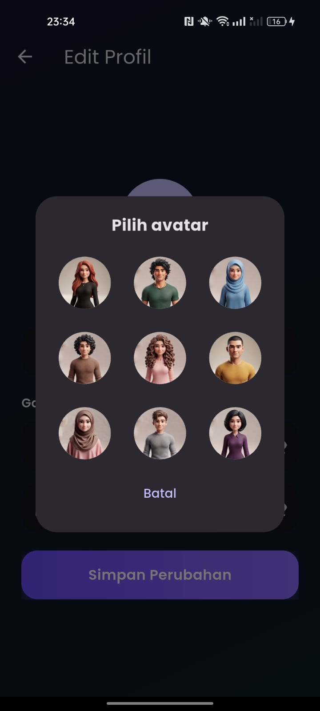 |
